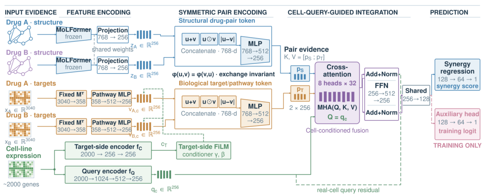

# SCIP-Syn

**Symmetric Contextual Integration for Prioritization** is a cell-context-aware model for drug-synergy candidate ranking.



Frozen MoLFormer and target/pathway features form two exchange-invariant pair tokens. An independently encoded cell query reads the pair memory through cross-attention. The main application is finite-budget prioritization under drug-label cold start.

The architecture and manuscript result PNGs are listed in [docs/FIGURES.md](docs/FIGURES.md).

## Quick start

Python 3.10+ is required. Source code is licensed under MIT.

```bash
git clone https://github.com/liang110/SCIP-Syn.git
cd SCIP-Syn
python -m pip install torch==2.10.0 --index-url https://download.pytorch.org/whl/cpu
python -m pip install -e ".[figures]"
python -m unittest discover -s tests -v
python tools/run_toy.py --output demo-output
```

The toy run uses explicitly synthetic features and labels, requires no GPU, and checks training, checkpoint loading, prediction and order invariance. Its outputs are not biological benchmark results. See requirements-tested.txt for the audited environment.

## Reproduce manuscript results

```bash
python tools/reproduce_manuscript.py --output figure-output
# Numerical summaries only:
python tools/reproduce_manuscript.py --tables-only --output table-output
```

The SCIP-Syn benchmark includes eight internal methods, seven cross-regime trajectories and six external methods, including Molecular MLP. The command checks source hashes, regenerates means, sample SD and matched-control contrasts, and redraws Figures 2–3. Figure 2 retains line trajectories in (a), with an explicitly labeled base-2 PCC axis, and three-dimensional correlation bars in (b) and (c).

For candidate-level verification, run `python tools/verify_candidate_replay.py --output candidate-replay`. This CPU-only command replays 140 canonical score files and checks matched candidate pools, strong-label assignments, budgets, association metrics, enrichment, paired differences, distinct coverage and sensitivity summaries. See [evidence scope](docs/EVIDENCE.md); neither replay command trains or tunes a model.

The numerical source files, column definitions and figure/table mapping are described in [docs/REPRODUCTION.md](docs/REPRODUCTION.md). Drug-exposure assignments are provided in [data/drug_exposure.csv](data/drug_exposure.csv); they identify each drug's complete outer-training exposure in the archived evaluations.

## Data and scientific execution

[DATA.md](DATA.md) identifies DrugComb v1.5, the processed Loewe endpoint, feature specifications and source checksums. [data/README.md](data/README.md) explains the compact published data.

To obtain outer train/test sets from the matching processed ALMANAC input:

```bash
python tools/create_study_splits.py --input synergy_data_clean.csv --output study-splits
```

Training uses the fixed molecular and biological arrays in the documented NPZ schema, the archived fitting/validation assignment and configs/train.json. The tools accept explicit paths and verify the supplied input manifest.

```bash
scip-train --assets assets/frozen.npz --fit data/fit.csv --validation data/validation.csv --test data/test.csv --manifest data/hashes.json --config configs/train.json --variant full --output results/full
```

Use scip-predict --help and scip-evaluate --help for frozen prediction and canonical scoring. The same modules support target_input_off, static_query and static_target_context. Original datasets and pretrained models remain governed by their upstream terms; the source-code MIT license does not relicense them.

## Interpretation

The benchmark supports finite-budget candidate prioritization under the evaluated drug-label exposure rules. Reported point-mean rankings are descriptive. O’Neil predictions use ALMANAC-selected models without O’Neil-based model selection. Matched controls test conditional input contributions; dynamic target-side FiLM does not show a consistent positive retrieval increment. Order invariance is a structural property, separate from predictive accuracy.

## Citation and reproducibility

The data manifest pins the result files with SHA256 checksums and fixed LF text encoding. Cite the immutable commit used for the manuscript. [CITATION.cff](CITATION.cff) supplies software attribution, and [docs/REPRODUCTION.md](docs/REPRODUCTION.md) describes result reconstruction.
